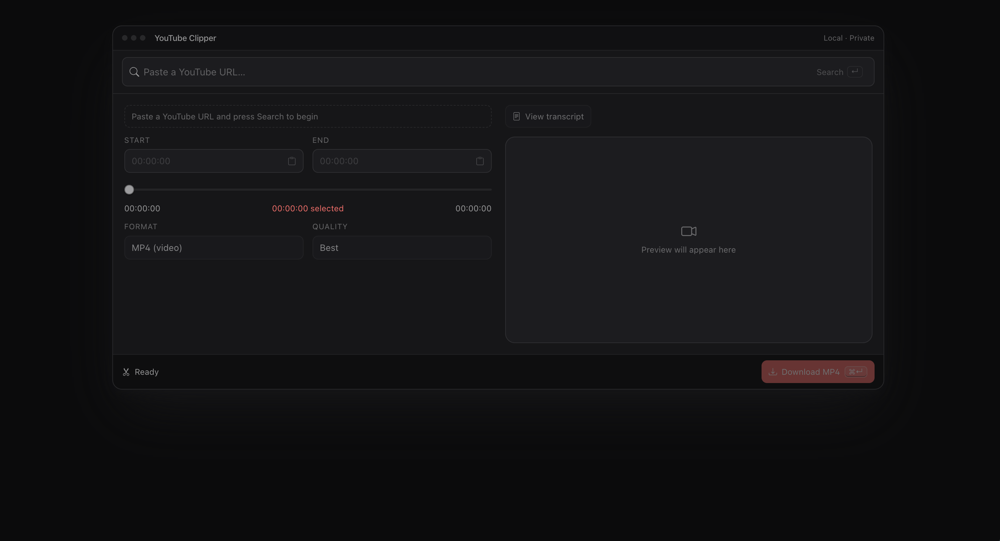

# YouTube Clipper

Download a trimmed section (up to 10 minutes) of a YouTube video — video or audio — fully on your own machine. Paste a link, pick a range, and save just the part you want. No accounts, no ads, no upload to anyone's server.



## Download the app

No terminal, no setup. These links always point at the newest release:

| Your computer | Download |
| --- | --- |
| **Windows 10/11** (64-bit) | [YouTube-Clipper-Windows-x64-Setup.exe](https://github.com/xxxxxLiam/stream-trimmer/releases/latest/download/YouTube-Clipper-Windows-x64-Setup.exe) |
| **macOS** (Apple Silicon) | [YouTube-Clipper-macOS-AppleSilicon.dmg](https://github.com/xxxxxLiam/stream-trimmer/releases/latest/download/YouTube-Clipper-macOS-AppleSilicon.dmg) |
| **Linux** (64-bit) | [YouTube-Clipper-Linux-x64.AppImage](https://github.com/xxxxxLiam/stream-trimmer/releases/latest/download/YouTube-Clipper-Linux-x64.AppImage) |

Or browse every build on the [Releases](../../releases) page — note that GitHub
hides the files under a collapsed **Assets** heading, so you may need to click
that to see them.

yt-dlp and ffmpeg are bundled inside the app. There is nothing else to install.

**The app is not code-signed**, because a signing certificate costs a few
hundred a year. That is normal for free open-source tools, but it means both
Windows and macOS will interrupt you once. Here is exactly what to click.

### Windows

There are up to three separate blocks, and each one looks final until you know
where the override is.

**1. Your browser may refuse to keep the file.** Edge and Chrome flag installers
that few people have downloaded yet.

- **Edge:** open the Downloads flyout (**Ctrl+J**), find the file, click the
  **⋯** next to it → **Keep**. If it asks again, choose **Show more** →
  **Keep anyway**.
- **Chrome:** same idea — in the download bar or **Ctrl+J**, click the **⋯** →
  **Keep**, then **Keep anyway** if prompted.

**2. Unblock the file before running it.** This step usually prevents the next
one entirely, and it is the one most people miss:

- Right-click `YouTube-Clipper-Windows-x64-Setup.exe` → **Properties**
- At the bottom of the **General** tab, tick **Unblock**
- **Apply** → **OK**, then double-click the installer

**3. If SmartScreen still appears**, you will see a blue window titled
**"Windows protected your PC"**. The only button is **Don't run** — the way
through is the small link:

- Click **More info** (under the message)
- Then click **Run anyway**

**If there is no "Run anyway" button at all,** Smart App Control is switched on.
That is a Windows 11 feature which blocks unsigned apps outright with no
override, and it is the one case where none of the above helps. Check
**Windows Security → App & browser control → Smart App Control**. If it says
**On**, your options are to turn it **Off** there, or not to install the app.

⚠️ Check whether you can undo it before you do it. Smart App Control used to be
a one-way switch: turning it off meant you could not turn it back on without
resetting or reinstalling Windows. That was relaxed in April 2026 — on Windows 11
24H2/25H2 with build 26100.8116 / 26200.8116 or newer, it can be toggled back
on. Run `winver` to see your build. On anything older, treat it as permanent.
Either way it is a real reduction in your machine's protection for the sake of
one app, so if you are not comfortable with that, the honest answer is to wait
until this app is signed.

### macOS

1. Open the `.dmg` and drag **YouTube Clipper** to your Applications folder.
2. macOS will refuse to open it: *"Apple could not verify YouTube Clipper is
   free of malware."* Clear the download flag from a terminal:

   ```bash
   xattr -dr com.apple.quarantine "/Applications/YouTube Clipper.app"
   ```

3. Open it normally.

You will need to run that command again after each update, because every
download arrives freshly quarantined. On recent macOS versions the old
right-click → **Open** trick no longer works for unsigned apps; the terminal
command, or **System Settings → Privacy & Security → Open Anyway**, is the way.

### Linux

```bash
chmod +x YouTube-Clipper-Linux-x64.AppImage
./YouTube-Clipper-Linux-x64.AppImage
```

## Features

- **Clip, don't download the whole thing.** Grabs only the time range you select (via yt-dlp's `--download-sections`), so a 5-minute clip from a 2-hour video downloads in seconds, not minutes.
- **Video or audio.** Export as **MP4** (video) or **MP3** (audio-only).
- **Quality control.** Pick resolution for video (up to 1080p) or bitrate for audio (up to 320 kbps).
- **Precise range selection** three ways: drag the dual-handle slider, type exact `HH:MM:SS` timestamps, or click lines in the transcript.
- **Transcript view.** Pull the video's captions for your selected range, search within them, and copy the text. Click any line to set it as your clip's start or end.
- **Choose where clips save** and name them automatically from the video title (desktop app).
- **Estimated file size.** See an approximate download size that updates as you change the range, format, and quality.
- **Runs 100% locally.** No accounts, ads, telemetry, or cloud — everything happens on your machine.

## Usage

1. **Paste** a YouTube URL and click **Search** (or press Enter). YouTube Shorts links work too.
2. The video loads and the range slider unlocks with the video's real length.
3. **Choose your clip range** — any of:
   - Drag the two slider handles, or
   - Type exact `HH:MM:SS` values in the Start / End fields (leave Start blank to begin from 0), or
   - Open the transcript and click a line to set it as the start or end.
4. Pick **Format** (MP4/MP3) and **Quality**. The estimated file size updates as you go.
5. Choose a **Save to** folder (desktop app), then click **Download** to save your clip.

> **Clip length is capped at 10 minutes.** Selections longer than that are blocked.

### Using the transcript

1. Click **View transcript** (above the preview). The video is replaced by the captions.
2. **Search** within the transcript using the search box.
3. **Click a line** to jump to it; use the inline **start/end** icons on a line to set that moment as your clip's start or end.
4. **Copy** grabs the transcript text for your selected range.

> Transcripts come from YouTube's auto-generated captions, so they may contain errors and lack punctuation. Not every video has captions available.

### About the file-size estimate

The size shown is an **estimate** (marked with `~`), calculated from the selected quality's bitrate and your clip length. The actual file may differ slightly — video bitrate varies moment to moment. MP3 estimates are more precise than MP4.

### A note on the video preview

Some creators disable embedded playback on their videos. When that happens the preview shows "Preview unavailable" — this is a YouTube setting, not an app error, and **it has no effect on downloading.** Clipping and downloading still work normally.

## Building from source

Only needed if you want to develop or build the app yourself.

### Run in dev (browser)

```sh
git clone <your-fork-or-this-repo> youtube-clipper
cd youtube-clipper
npm install
npm run dev
```

Then open **http://localhost:8080**. A single `npm run dev` starts the Vite front-end and the local worker together.

### Build the desktop app

```sh
npm run dist:mac     # macOS .dmg (run on a Mac)
npm run dist:win     # Windows .exe (run on Windows)
npm run dist:linux   # Linux AppImage
```

Installers are written to `dist-electron/`. Each OS's installer must be built on that OS (or via CI) — you can't cross-build a Windows `.exe` from macOS.

### Prerequisites (source builds only)

- **Node.js 18+** (see `.nvmrc`).
- **ffmpeg**, **yt-dlp**, and **deno** are downloaded and bundled automatically during the build (`scripts/bundle-binaries.cjs`). The packaged app ships them inside `Resources/bin`, so end users install nothing.

## How it works

A React single-page app (Vite + TypeScript) talks to a local Express worker. The worker runs **yt-dlp** to fetch just your selected section and **ffmpeg** to trim it, then delivers the file. In dev, both run via `npm run dev` on localhost. In the packaged desktop app, Electron serves the built front-end and runs the worker in-process on a private local port; yt-dlp, ffmpeg, and deno are bundled in the app and invoked directly (spaces in the install path are handled).

## Scripts

| Command                                        | What it does                                            |
| ---------------------------------------------- | ------------------------------------------------------- |
| `npm install`                                  | Installs dependencies and runs the setup check.         |
| `npm run setup`                                | Re-checks that yt-dlp and ffmpeg are available.         |
| `npm run dev`                                  | Dev mode (front-end + worker) at http://localhost:8080. |
| `npm run build`                                | Builds the front-end.                                   |
| `npm run dist:mac` / `dist:win` / `dist:linux` | Builds the packaged desktop installer for that OS.      |

## Troubleshooting

**Using the app:**

- **Can't find the installer on the Releases page** — GitHub collapses the file
  list under an **Assets** heading. Click it, or use the direct links at the top
  of this page, which always point at the newest build.
- **Windows: no "Run anyway" option appears** — that is Smart App Control, not
  SmartScreen. See [Windows](#windows) above; SmartScreen can be clicked
  through, Smart App Control cannot.
- **"Preview unavailable"** — the video owner disabled embedding. Downloading still works; ignore it.
- **"No transcript available"** — that video has no captions (or none in a supported language). A YouTube limitation, not a bug.
- **"yt-dlp failed" with details** — if YouTube changed something and the bundled yt-dlp is behind, grab the newest release build, which bundles an updated yt-dlp.
- **"Sign in to confirm you're not a bot"** — YouTube is challenging an
  unauthenticated request. Import a cookies.txt (below). If you already have,
  the session may have been rotated out — re-export it from a private window,
  which is the step that makes it last.
- **"Chrome is running and holding its cookie database open"** — Windows gives
  the running browser an exclusive lock. Quit it fully, including tray
  processes, or use **Import cookies.txt**.
- **"Chrome encrypts its cookies so other apps can't read them"** — Chrome 127+
  App-Bound Encryption. There is no way around it from outside the browser;
  **Import cookies.txt** is the answer, because the browser decrypts on export.

### Import cookies.txt

This is how the app signs in. There is no in-app Google sign-in: Google
blocks Google Account sign-in from inside other applications as policy, and
has since January 2021, so no amount of work in this app can make it succeed.

**Export from a private window.** YouTube rotates account cookies on open
YouTube tabs as a security measure, so a file exported from your normal
browsing is invalidated within hours — that is why a plain export seems to
"stop working" and need redoing. A private session you close and never reopen
is never rotated.

1. Open a new private browsing/incognito window and log into YouTube.
2. In the same window and same tab, go to `https://www.youtube.com/robots.txt`.
   This should be the only private/incognito tab open.
3. Export youtube.com cookies with a "Get cookies.txt LOCALLY" style extension.
4. Close the private window, so that session is never opened in the browser
   again.
5. In the app: **Connect YouTube → Import cookies.txt**, and pick that file.

The procedure is yt-dlp's own; see its
[Exporting YouTube cookies](https://github.com/yt-dlp/yt-dlp/wiki/Extractors#exporting-youtube-cookies)
wiki page. The browser decrypts on export, so this works regardless of whether
the browser is running or how it encrypts its cookie store. The file is
validated (it must contain a real YouTube sign-in cookie), stored in the app's
own data folder, and read only by the local yt-dlp process — which also
refreshes it after each run, so one good import lasts.

Reading a browser's cookies directly (**Find my YouTube session**) is offered
as a secondary route. Firefox works reliably; Chrome and Chromium on Windows
cannot be read at all, because Chrome 127+ encrypts the cookie database
against other programs. Cookies obtained that way are the rotating kind, so
expect to redo them.

Note that 1080p does not itself require a sign-in. Cookies are needed for
age-restricted, members-only and private content, and to clear bot checks.

**Building from source:**

- **`✗ yt-dlp not found` in dev** — install it for your OS (macOS `brew install yt-dlp`, Windows `winget install yt-dlp.yt-dlp`, Linux `sudo apt install yt-dlp`), then `npm run setup`. The app auto-uses a system yt-dlp if the bundled one is missing.
- **`EADDRINUSE` (port in use)** — a previous dev run is still holding the port. Free it: `lsof -ti :5174 | xargs kill` (macOS/Linux), then `npm run dev`.
- **A binary silently failed to download during build** — run `npm install --foreground-scripts` to see the output.

## Legal & responsible use

This is a neutral, general-purpose tool. Use it only for content you own or have the rights to download — your own uploads, public-domain material, Creative Commons works, or clips you have permission to save. Respect [YouTube's Terms of Service](https://www.youtube.com/t/terms) and applicable copyright law. Built on the excellent [yt-dlp](https://github.com/yt-dlp/yt-dlp) — please read their notes on responsible use.

## Maintenance

Provided as-is and **unmaintained**. If yt-dlp/ffmpeg change behaviour or YouTube breaks things, fork the repo and update at your own discretion. Issues and PRs may not receive a response.

## Releasing new versions (auto-update)

The desktop app auto-updates via `electron-updater`, reading from this repo's
GitHub Releases. Each release must contain the platform installer **plus** the
matching metadata file that `electron-builder` uploads:

- Windows: `latest.yml`
- macOS: `latest-mac.yml`
- Linux: `latest-linux.yml`

Without those `.yml` files the app cannot detect a new version.

### Releases are automatic

`.github/workflows/release.yml` runs on every push to `main` — so **merging a
pull request cuts a release**. There is nothing to do by hand.

The workflow, in order:

1. **verify** — `npm ci`, `tsc --noEmit`, `npm test`. Nothing is tagged unless
   these pass.
2. **version** — works out the bump (below), runs `npm version`, pushes the
   `Release vX.Y.Z` commit and its tag.
3. **build** — native installers, in parallel on their own OS runners:
   - `macos-latest` → `YouTube-Clipper-<version>-macOS-AppleSilicon.dmg` (arm64)
   - `windows-latest` → `YouTube-Clipper-<version>-Windows-x64-Setup.exe`
   - `ubuntu-latest` → `YouTube-Clipper-<version>-Linux-x64.AppImage`
4. **publish** — flips the release public, marks it latest, and writes notes
   from the commits since the previous tag.

Steps 3 and 4 are separate on purpose. `electron-builder` uploads into a
*draft* release, so a half-finished one — macOS uploaded, Windows still
building — is never visible. If any platform fails, the draft stays a draft
and nothing is published.

Authentication uses the built-in `GITHUB_TOKEN`; no personal access token is
needed.

#### How the version bump is chosen

Read from the commit messages since the last release tag. First match wins:

| Bump      | Triggered by                                              |
| --------- | --------------------------------------------------------- |
| **major** | `[major]` in a commit **subject**, a `BREAKING CHANGE:` footer, or `feat!:` / `fix!:` (any type with `!`) |
| **minor** | `[minor]` in a commit **subject**, or `feat:` / `feat(scope):` |
| **patch** | anything else — the default                               |

Plain-English commit messages therefore get a **patch**. To ask for something
else, put `[minor]` / `[major]` in a commit's first line, or use the
Conventional-Commits prefix.

Markers are read from commit **subjects** only — never bodies. Bodies are
prose, and anything matched there gets matched by accident eventually: the
first version of this read bodies, and a commit whose body merely *described*
the markers released v3.0.0 for a bugfix. `BREAKING CHANGE:` is the one
body-level signal, and must start a line, case-sensitively, with its colon —
so "this is not a breaking change" cannot trigger a major.

The logic is in `scripts/detectBump.cjs` and covered by
`server/detectBump.test.ts`, so it can be changed without guessing.

#### Overrides

- **Force a bump:** Actions → Release → *Run workflow*, and pick
  `patch` / `minor` / `major` instead of `auto`.
- **Skip the release for one merge:** put `[skip release]` in the merge
  commit message.

The release's own `Release vX.Y.Z` commit never re-triggers the workflow —
GitHub does not fire workflows for pushes made with `GITHUB_TOKEN`, and the
job additionally skips any commit whose message starts with `Release v`.

### Optional fallback: build locally

Only needed if CI is unavailable. Build the installer for **the OS you're
on** — you cannot cross-build (that's the bug this workflow exists to
prevent). Requires a GitHub PAT with `repo` scope as `GH_TOKEN`:

```sh
export GH_TOKEN=ghp_your_token_here
npm run release:mac     # on macOS (arm64 only)
npm run release:win     # on Windows (x64)
npm run release:linux   # on Linux (x64)
```

### Platform notes

- **Windows (NSIS)** — auto-update works unsigned; users see a one-time
  SmartScreen prompt on first install.
- **Linux (AppImage)** — auto-update works unsigned. The app must have been
  launched from an AppImage file.
- **macOS (DMG)** — auto-update requires the app to be **signed AND
  notarized**. Until an Apple Developer certificate is configured, mac users
  will see an update notification but the install will fail; they need to
  download the new DMG manually from the Releases page. The app handles this
  gracefully — it does not crash.

## License

[MIT](./LICENSE).

## Channel data tool (private builds only)

The channel profile exporter is not part of the public app. There is no
passcode. It is compiled in only when you build with a flag, so the downloads
other people get contain no exporter screen and no exporter endpoint.

| Variable | Purpose |
| --- | --- |
| `VITE_ENABLE_CHANNEL_DATA` | Off by default. Set to `1` to build the tool in. |
| `VITE_OWNER_SALT` | Any long random string, used to salt device hashes. |
| `VITE_OWNER_MACHINES` | Comma-separated device hashes allowed to see the tool. `*` means any machine. |

1. Put the variables in a local `.env` (gitignored, see `.env.example`).
2. Add a device: run `npm run machine-id` on that computer and append the hash it
   prints to `VITE_OWNER_MACHINES`.
3. Build your private copy by hand, for example
   `VITE_ENABLE_CHANNEL_DATA=1 npm run dist:mac`.

The public release workflow leaves `VITE_ENABLE_CHANNEL_DATA` empty on purpose.
Your private build is separate from the auto-updating public release: rebuild it
by hand when you want a newer one.

Honest limit: in a build that has the tool, the code is present and the device
list is in the bundle, so someone with developer tools could find it. This is
obscurity plus a device check, not a security boundary. Leaving the flag off is
what removes the feature entirely.
